**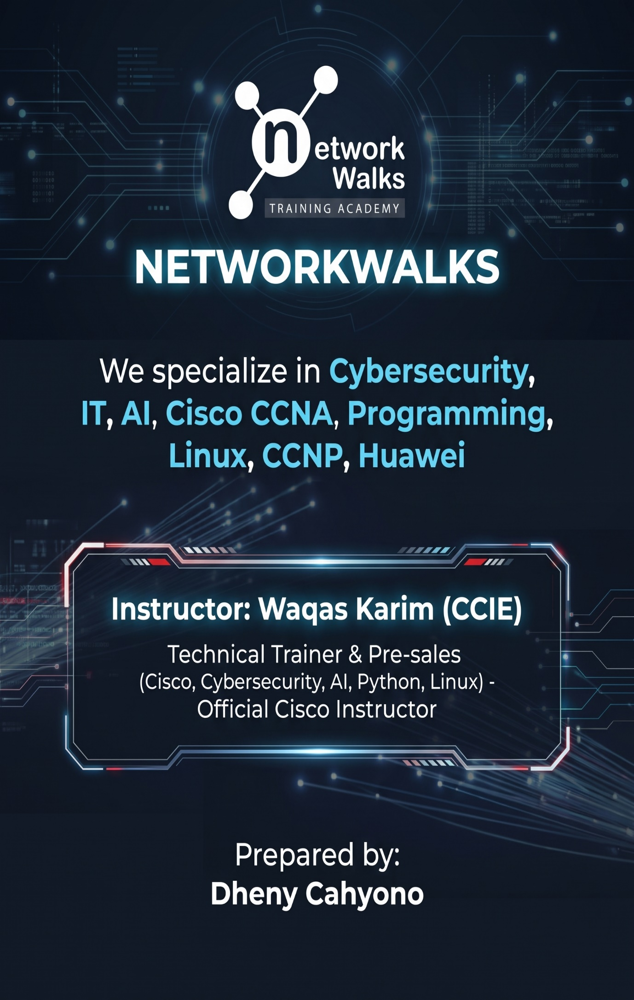**

# Table of contents

**page**

[Table of contents 3](#table-of-contents)

[Scope task 4](#scope-task-)

[EXECUTIVE SUMMARY 5](#executive-summary)

[NETWORKWALKS LETTER OF AUTHORIZATION FOR CYBERSECURITY TESTING 5](#networkwalksletter-of-authorization-for-cybersecurity-testing)

[1.1 Engagement Overview 5](#11-engagement-overview)

[1.2 Summary of Findings and Recommendations (Key Findings & Recommendations) 5](#12-summary-of-findings-and-recommendations-key-findings--recommendations)

[Scope and methodology 6](#scope-and-methodology)

[Findings and Proof of Exploitation M1 7](#findings-and-proof-of-exploitationm1)

[2.1 Task M1 7](#21-task-m1)

[2.2 what I do 8](#22-what-i-do)

[2.4 sql injection 9](#24-sql-injection)

[Findings and Proof of Exploitation M2 10](#findings-and-proof-of-exploitationm2)

[3.1 how I do to open pdf 10](#31-how-i-do-to-open-pdf)

[3.1 special case patient_report_3 14](#31-special-case-patient_report_3)

[Findings and Proof of Exploitation M3 15](#findings-and-proof-of-exploitationm3)

[3.1 ffuf 16](#31-ffuf-)

[Risk Rating 19](#risk-rating)

[Recommendation 20](#recommendation)

# Scope task

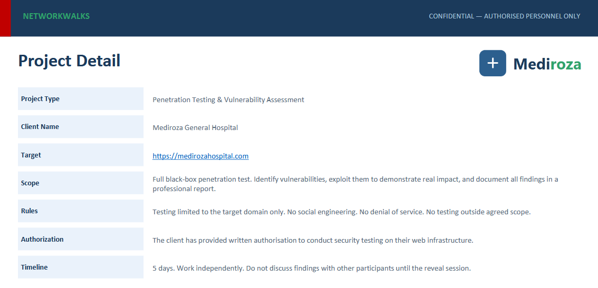

# EXECUTIVE SUMMARY

## NETWORKWALKS

LETTER OF AUTHORIZATION FOR CYBERSECURITY TESTING

| **Date of issue**              | 24 November 2026                                            |
| ------------------------------ | ----------------------------------------------------------- |
| **Client / Target owner**      | Networkwalks.com / target : <https://medirozahospital.com/> |
| **Authorized tester (Intern)** | Dheny Cahyono                                               |
| **Program / Batch**            | B084 - Networkwalks Cybersecurity Internship                |
| **Authorization valid**        | 24 November 2026 to 29 November 2026                        |

## 1.1 Engagement Overview

On November 24, 2026, the security testing team (Red Team) conducted a full black-box penetration test on the client's web application (medirozahospital.com). The primary objective of this assessment was to simulate cyberattacks from the perspective of an external threat actor—without prior access to credentials or source code. The testing aimed to identify system vulnerabilities, demonstrate the potential real-world impact of exploitation by malicious parties, and provide recommendations for remediation to strengthen the application's security posture.

## 1.2 Summary of Findings and Recommendations (Key Findings & Recommendations)

| **Vulnerability**                                                                                                                                                    | **Level** | **Remediation**                                                                                                            |
| -------------------------------------------------------------------------------------------------------------------------------------------------------------------- | --------- | -------------------------------------------------------------------------------------------------------------------------- |
| **Authentication Bypass (SQL Injection)**  Query manipulation in the login form patient (admin' --) grants full access as an Administrator without a password. | Critical  | Immediately implement Prepared Statements (Parameterized Queries) on the backend for all user input.                       |
| **Directory Information Disclosure**  Public files such as robots.txt expose the locations of administrative portals (e.g., /old/).                            | middle    | Implement access controls for all page—for example, by restricting access to an IP whitelist or the client's internal VPN. |
|                                                                                                                                                                      |           |                                                                                                                            |

# Scope and methodology

| Testing Components | detail                                                                                                                                                                                                                                                                                                                                                                                                                                                                                                                                                                                                        |
| ------------------ | ------------------------------------------------------------------------------------------------------------------------------------------------------------------------------------------------------------------------------------------------------------------------------------------------------------------------------------------------------------------------------------------------------------------------------------------------------------------------------------------------------------------------------------------------------------------------------------------------------------- |
| Scope (Target)     | (Target) Web application infrastructure (\[<https://medirozahospital.com\>](<https://medirozahospital.com>)) and recovery of access to encrypted PDF documents.                                                                                                                                                                                                                                                                                                                                                                                                                                               |
| Tools Used         | 1\. **ffuf**: Searching for hidden directories and endpoints using your own custom wordlist.  **2\. Manual SQLi Payloads:** Database vulnerability testing—directly attempting SQL injection in the patient login input form.  **3\. pdf hash crack :** <https://www.onlinehashcrack.com/tools-pdf-hash-extractor.php#extract>  **4\. NetworkWalks password Cracker :** <https://networkwalks.com/password-cracker/> to crack password from hash pdf file.  **5.** **Rockyou.txt:** A password dictionary for dictionary attacks, included in the NetworkWalks password cracker tool. |
| Approach           | 1\. **Reconnaissance**: Endpoint mapping using ffuf.  2\. **Exploitation**: Manual SQL injection attack.  3\. **Cryptographic** Attack: Extraction of PDF hashes and execution of a cracking process using a wordlist.                                                                                                                                                                                                                                                                                                                                                                            |
| Limitations        | A hash format incompatibility has rendered JTR unusable; the solution is to use the NetworkWalks password cracker tool, supplemented with the \`rockyou.txt\` wordlist.                                                                                                                                                                                                                                                                                                                                                                                                                                       |

# Findings and Proof of Exploitation

M1

## 2.1 Task M1

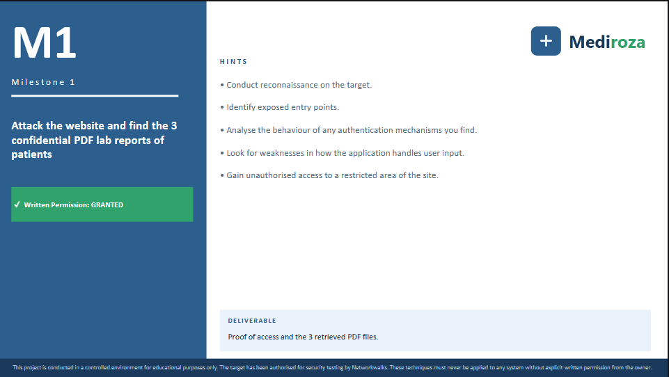

## 2.2 what I do

Am try to use whois

# whois

┌──(kali㉿dheny)-\[~\]

└─\$ whois medirozahospital.com

Domain Name: MEDIROZAHOSPITAL.COM

Registry Domain ID: 3132326963_DOMAIN_COM-VRSN

Registrar WHOIS Server: whois.namecheap.com

Registrar URL: <http://www.namecheap.com>

Updated Date: 2026-08-14T21:07:45Z

Creation Date: 2026-08-14T20:51:24Z

Registry Expiry Date: 2027-08-14T20:51:24Z

Registrar: NameCheap, Inc.

Registrar IANA ID: 1068

Registrar Abuse Contact Email: <abuse@namecheap.com>

Registrar Abuse Contact Phone: +1.6613102107

Domain Status: clientTransferProhibited <https://icann.org/epp#clientTransferProhibited>

Name Server: DNS1.NAMECHEAPHOSTING.COM

Name Server: DNS2.NAMECHEAPHOSTING.COM

DNSSEC: unsigned

URL of the ICANN Whois Inaccuracy Complaint Form: <https://www.icann.org/wicf/>

\>>> Last update of whois database: 2026-11-24T01:28:45Z <<<

## 2.4 sql injection

# am try

<https://medirozahospital.com/patient/login.php>

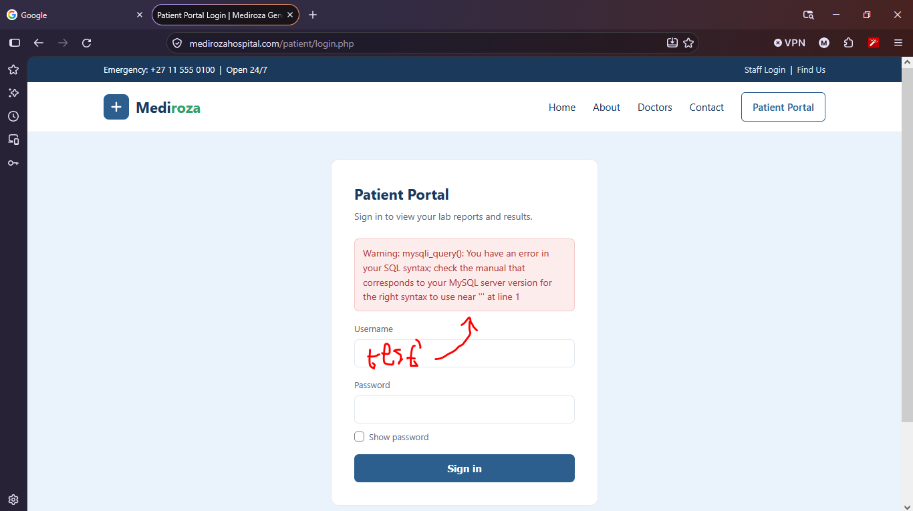

Warning: mysqli_query(): You have an error in your SQL syntax; check the manual that corresponds to your MySQL server version for the right syntax to use near ''' at line 1

So I do admin' in username input and then page login succeed to bypass with sql injection

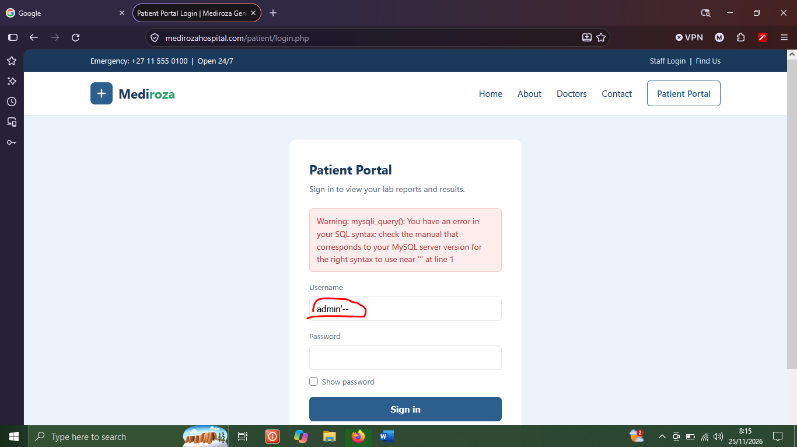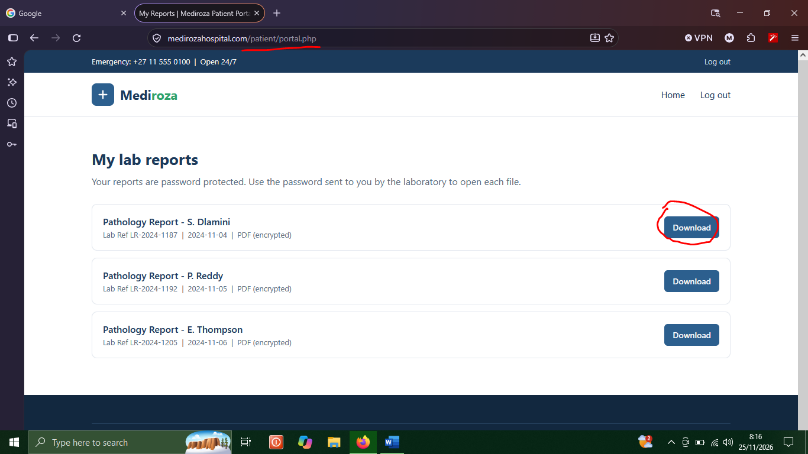

# Findings and Proof of Exploitation

M2

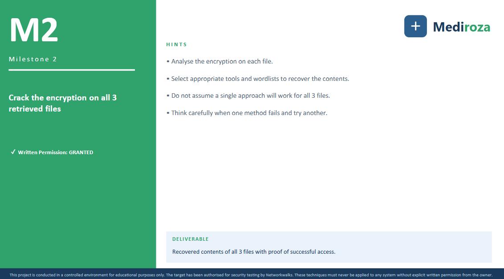

## 3.1 how I do to open pdf

After I access bypass patient login with sql I can download 3 file and use <https://networkwalks.com/password-cracker/> to open pdf before that I Extracted hash script pdf use <https://www.onlinehashcrack.com/tools-pdf-hash-extractor.php#extract> and save result extract to the txt file and import that text \$pdf\$ to <https://networkwalks.com/password-cracker/> .

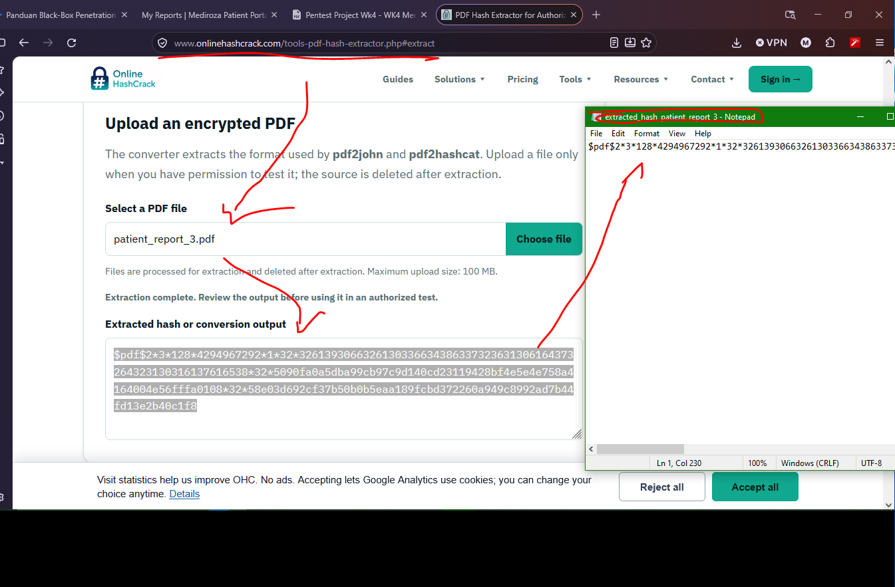

Password

Patient_report_1

Password : 123456

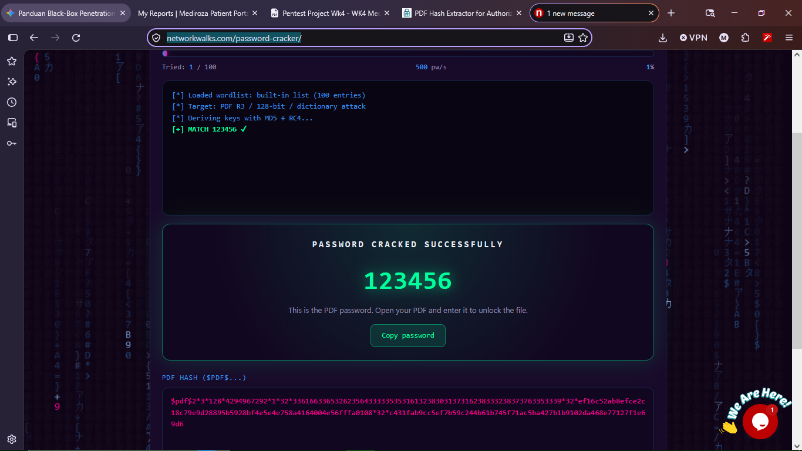

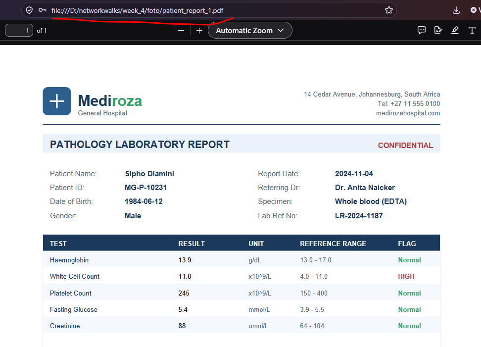

Dokumen : patient_report_2

Password : password

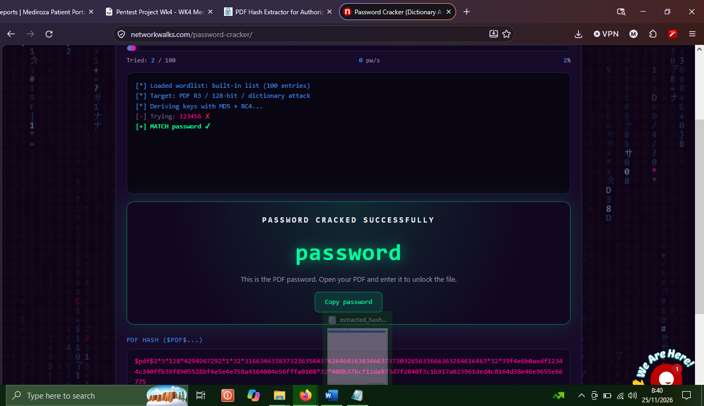

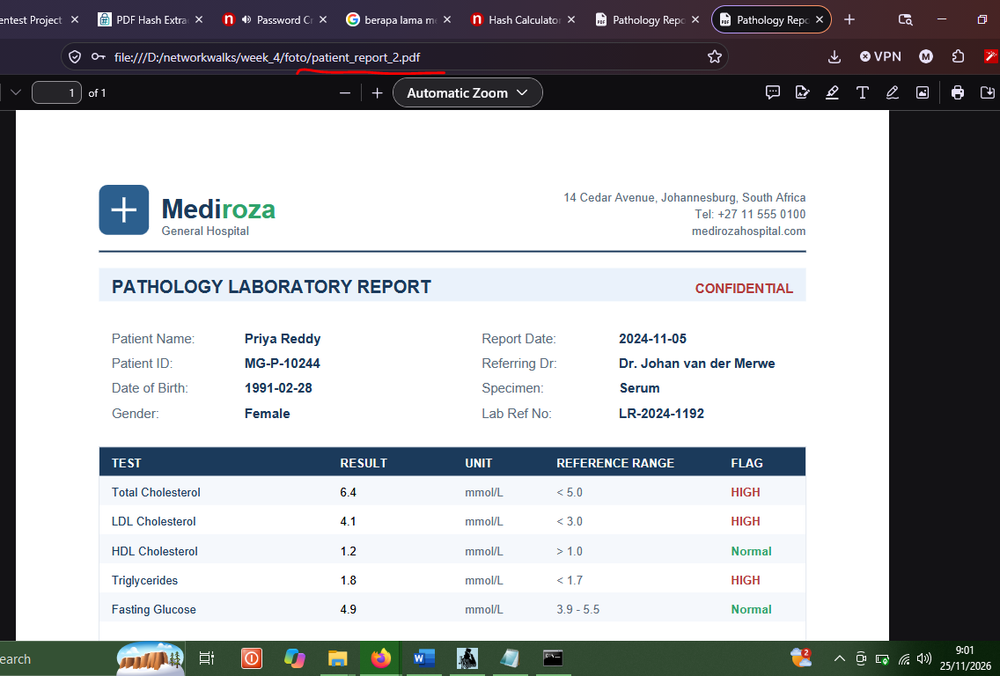

## 3.1 special case patient_report_3

\# to open patient_report_3 am use <https://networkwalks.com/password-cracker/> with add wordlist **rockyou.txt**

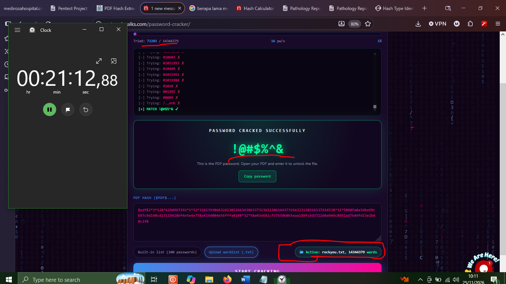

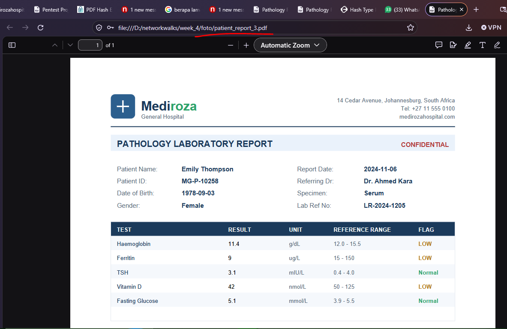

# Findings and Proof of Exploitation

M3

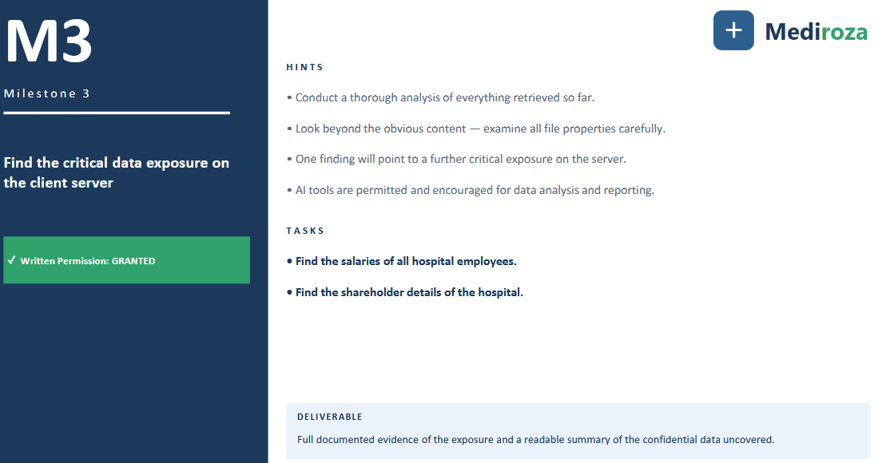

## 3.1 ffuf

# Am use ffuf use my custom wordlist

┌──(kali㉿dheny)-\[~\]

└─\$ ffuf -w /home/kali/Documents/wordlist_test.txt -u <https://medirozahospital.com/FUZZ> -fc 404

/'\_**\\ /'\_**\\ /'\___\\

/\\ \\\__/ /\\ \\\__/ \__\__ /\\ \\\__/

\\ \\ ,\__\\\\ \\ ,\__\\/\\ \\/\\ \\ \\ \\ ,\__\\

\\ \\ \\\_/ \\ \\ \\\_/\\ \\ \\\_\\ \\ \\ \\ \\\_/

\\ \\\_\\ \\ \\\_\\ \\ \\\___\_/ \\ \\\_\\

\\/\_/ \\/\_/ \\/\___/ \\/\_/

v2.3.0

\_**\_**\_**\_**\_**\_**\_**\_**\_**\_**\_**\_**\_**\_**\_**\_**

:: Method : GET

:: URL : <https://medirozahospital.com/FUZZ>

:: Wordlist : FUZZ: /home/kali/Documents/wordlist_test.txt

:: Follow redirects : false

:: Calibration : false

:: Timeout : 10

:: Threads : 40

:: Matcher : Response status: 200-299,301,302,307,401,403,405,500

:: Filter : Response status: 404

\_**\_**\_**\_**\_**\_**\_**\_**\_**\_**\_**\_**\_**\_**\_**\_**

wp-admin \[Status: 200, Size: 745, Words: 24, Lines: 1, Duration: 426ms\]

old \[Status: 301, Size: 795, Words: 60, Lines: 14, Duration: 429ms\]

robots.txt \[Status: 403, Size: 1242, Words: 106, Lines: 15, Duration: 2246ms\]

:: Progress: \[12/12\] :: Job \[1/1\] :: 5 req/sec :: Duration: \[0:00:09\] :: Errors: 0 ::

So I do to try access :

<https://medirozahospital.com/old/>

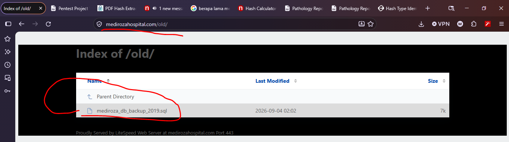

I found sql file mediroza_db_backup_2019.sql and extract to excel

<https://medirozahospital.com/old/mediroza_db_backup_2019.sql>

an I found :

Find the salaries of all hospital employees.

| **ID** | **Full Name**           | **Job Title**            | **Monthly Salary (ZAR)** |
| ------ | ----------------------- | ------------------------ | ------------------------ |
| 1      | Dr. Rajesh Naidoo       | Chief Pathologist        | R 138.000                |
| 2      | Sarah Botha             | Chief Financial Officer  | R 152.000                |
| 3      | Dr. Johan van der Merwe | Medical Director         | R 160.000                |
| 4      | Dr. Anita Naicker       | Consultant Cardiologist  | R 132.000                |
| 5      | Dr. Ahmed Kara          | Consultant Physician     | R 128.000                |
| 6      | Dr. Yusuf Cassim        | Senior Registrar         | R 74.000                 |
| 7      | Michael Roberts         | HR Director              | R 96.000                 |
| 8      | Susan Pretorius         | HR Officer               | R 32.000                 |
| 9      | Jameel Malik            | IT Systems Administrator | R 58.000                 |
| 10     | Thabo Molefe            | Network Engineer         | R 46.000                 |
| 11     | Nomvula Khumalo         | Registered Nurse         | R 34.000                 |
| 12     | Lerato Mokoena          | Registered Nurse         | R 33.000                 |
| 13     | Bongani Ndlovu          | Registered Nurse         | R 35.000                 |
| 14     | Zanele Mahlangu         | Nursing Sister           | R 42.000                 |
| 15     | Kagiso Sithole          | Pharmacist               | R 61.000                 |
| 16     | Naledi Zulu             | Pharmacy Assistant       | R 26.000                 |
| 17     | Themba Nkosi            | Radiographer             | R 44.000                 |
| 18     | Palesa Radebe           | Radiographer             | R 43.000                 |
| 19     | Deepak Pillay           | Lab Technologist         | R 41.000                 |
| 20     | Kavitha Govender        | Lab Technician           | R 35.000                 |
| 21     | Dr. Suresh Moodley      | Consultant Radiologist   | R 130.000                |
| 22     | Dr. Fatima Patel        | Pediatrician             | R 118.000                |
| 23     | Nisha Singh             | Physiotherapist          | R 48.000                 |
| 24     | Dr. Vikram Chetty       | Anaesthetist             | R 135.000                |
| 25     | David Smith             | Facilities Manager       | R 52.000                 |
| 26     | Karen O'Connor          | Billing Administrator    | R 29.000                 |
| 27     | James Wilson            | Security Supervisor      | R 27.000                 |
| 28     | Linda Fourie            | Receptionist             | R 19.000                 |
| 29     | Peter van Wyk           | Procurement Officer      | R 38.000                 |
| 30     | Andile Mbeki            | Ward Clerk               | R 21.000                 |

• Find the shareholder details of the hospital

| **ID** | **Shareholder Name**            | **Share Percent (%)** | **Shares Held** | **Share Class** |
| ------ | ------------------------------- | --------------------- | --------------- | --------------- |
| 1      | Dr. Rajesh Naidoo               | 18,00%                | 180.000         | Ordinary        |
| 2      | Cedar Health Holdings (Pty) Ltd | 15,00%                | 150.000         | Ordinary        |
| 3      | Dr. Johan van der Merwe         | 12,00%                | 120.000         | Ordinary        |
| 4      | Reddy Family Trust              | 11,00%                | 110.000         | Ordinary        |
| 5      | Thabo Molefe                    | 10,00%                | 100.000         | Ordinary        |
| 6      | Sarah Botha                     | 9,00%                 | 90.000          | Ordinary        |
| 7      | Dr. Ahmed Kara                  | 8,00%                 | 80.000          | Preferential    |
| 8      | Naledi Zulu                     | 7,00%                 | 70.000          | Ordinary        |
| 9      | Michael Roberts                 | 6,00%                 | 60.000          | Ordinary        |
| 10     | Dr. Vikram Chetty               | 4,00%                 | 40.000          | Preferential    |

# Risk Rating

| **Vulnerability**            | **Risk Rating** | **Justification**                                                                                                                                                                |
| ---------------------------- | --------------- | -------------------------------------------------------------------------------------------------------------------------------------------------------------------------------- |
| **SQL Injection (SQLi)**     | Critical        | Allows attackers to bypass authentication and extract sensitive backend database records (such as encrypted staff documents) without valid credentials.                          |
| **Directory Disclosure**     | Medium          | Exposes hidden web endpoints and sensitive files (e.g., restricted PDFs) to the public, significantly expanding the attack surface.                                              |
| **Missing Security Headers** | Low             | Fails to protect users from client-side attacks like Clickjacking or Cross-Site Scripting (XSS), though successful exploitation requires social engineering or user interaction. |

# Recommendation

| **Vulnerability**        | **Actionable Remediation Steps**                                                                                                                                                                                                                                                                                  |
| ------------------------ | ----------------------------------------------------------------------------------------------------------------------------------------------------------------------------------------------------------------------------------------------------------------------------------------------------------------- |
| **SQL Injection (SQLi)** | • Implement **Prepared Statements (Parameterized Queries)** for all database interactions to prevent raw SQL execution.  • Enforce strict input validation and sanitization on all user-supplied data.  • Apply the Principle of Least Privilege to the database account used by the web application. |
| **Directory Disclosure** | • Disable directory indexing globally on the web server (e.g., Options -Indexes in Apache or autoindex off in Nginx).  • Restrict direct access to sensitive directories or internal files (like PDFs) using strict role-based access control (RBAC) or authentication checks.                              |

 

**👤 Author Dheny Cahyono** Intern Networkwalks B084 LinkedIn: https://www.linkedin.com/in/dheny-cahyono/ 

#### **👤 Project Information** 

**Program Name:** Cybersecurity program at Networkwalks | **Week:** 04 | **Repository:** GitHub 

Pentesting Project Report  |  Networkwalks  |  
